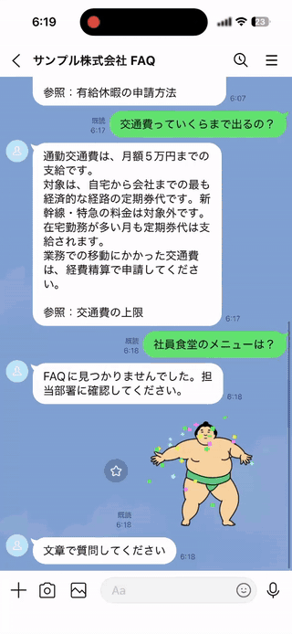
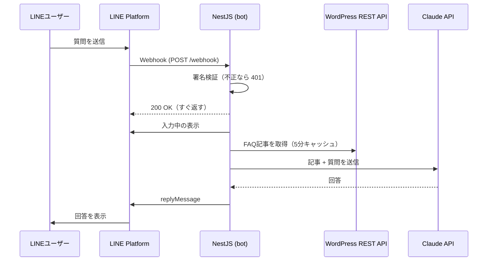
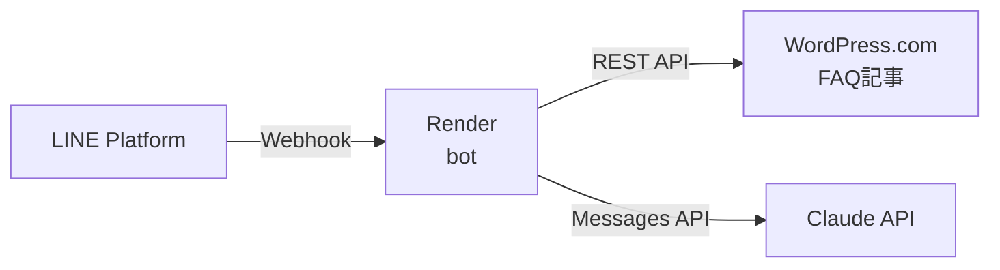

# 社内FAQ LINE bot

[](https://github.com/tamuraKango/line-faq-bot/actions/workflows/ci.yml)

LINE で質問すると、WordPress に登録された社内FAQ記事をもとに Claude が回答する bot です。
Claude API・LINE Messaging API・WordPress REST API を連携した、業務効率化の試作です。

- FAQ に書かれている内容だけで答え、最後に参照した記事のタイトルを付けます
- FAQ に書かれていない質問には「見つかりませんでした」と答え、内容をでっち上げません

<p align="center">
  
</p>

仕様は [docs/design.md](docs/design.md) にまとめています。

## 構成



| モジュール | 役割 |
|---|---|
| [`src/line/`](src/line/) | Webhook の受信、署名検証、入力中の表示、返信 |
| [`src/faq/`](src/faq/) | 全体の流れ（記事を取得し、回答を作る） |
| [`src/wordpress/`](src/wordpress/) | 記事の取得、HTML の除去、キャッシュ |
| [`src/ai/`](src/ai/) | プロンプトの組み立てと Claude の呼び出し |
| [`src/config/`](src/config/) | 環境変数のチェック（足りなければ起動しない） |

## 工夫した点

- **署名検証を省略しない**：`x-line-signature` を、JSON に変換する前の生のリクエストボディで検証し、不正なら 401 を返します
- **LINE には先に 200 を返す**：回答の作成は待たずに進め、Webhook がタイムアウトしないようにしています。回答を作っている間は、トーク画面に入力中のアニメーションを出します
- **でっち上げないプロンプト**：記事を `<documents>` にまとめて渡し、「書かれていないことは答えない」「該当がなければ決まった文で答える」「参照した記事を書く」と指示しています
- **速さと料金**：モデルは Claude Haiku 5.5、effort は `low` にしています。記事は5分間キャッシュし、WordPress に毎回アクセスしないようにしています。質問1回あたりの料金は約0.1円です
- **失敗しても黙らない**：WordPress や Claude の呼び出しに失敗したときは、「ただいま回答できません」と返します。ログには原因（接続できない、API キーが無効、混雑など）を出します
- **秘密情報を出さない**：API キーやトークンはログやエラーメッセージに含めません。質問の本文をログに出すのは開発時（`NODE_ENV=development`）だけです
- **テストと CI**：ユニットテストと e2e テストを、PR ごとに GitHub Actions で実行しています。外部の API（LINE、WordPress、Claude）はモックにしています

## 技術スタック

- NestJS（TypeScript）/ Node.js LTS
- `@line/bot-sdk`（LINE Messaging API）
- `@anthropic-ai/sdk`（Claude API、モデルは `claude-haiku-5-5`）
- WordPress + MySQL（Docker Compose）
- Vitest、oxlint、GitHub Actions

## セットアップ

### 必要なもの

- Node.js（LTS）
- Docker Desktop
- ngrok（LINE から Webhook を受け取るため）
- LINE Messaging API のチャネル
- Claude API キー（[Claude Console](https://console.anthropic.com/) で発行。クレジットの購入が必要です）

### 1. 依存パッケージと環境変数

```powershell
npm install
Copy-Item .env.example .env
```

`.env` に次の値を入れます。`.env` はコミットしません。

| 変数名 | 内容 |
|---|---|
| `LINE_CHANNEL_SECRET` | LINE Developers の「チャネル基本設定」にあるチャネルシークレット |
| `LINE_CHANNEL_ACCESS_TOKEN` | 「Messaging API設定」で発行するチャネルアクセストークン（長期） |
| `ANTHROPIC_API_KEY` | Claude API キー |
| `ANTHROPIC_MODEL` | 使うモデル（未設定なら `claude-haiku-5-5`） |
| `WP_DB_PASSWORD` / `WP_DB_ROOT_PASSWORD` | ローカルの MySQL 用。適当な長い文字列でよい |
| `WP_ADMIN_PASSWORD` | WordPress 管理画面（ユーザー名 `admin`）のパスワード |

### 2. WordPress を起動し、サンプルFAQを入れる

```powershell
docker compose up -d
npm run seed
```

- http://localhost:8080 で、サンプルFAQ 10件が表示されます
- 管理画面は http://localhost:8080/wp-admin です
- 記事は [wordpress/seed/posts/](wordpress/seed/posts/) にあります。1行目がタイトル、2行目以降が本文（HTML）です。直してから `npm run seed` を再実行すると、同じ記事が更新されます（重複はしません）
- データをすべて消して作り直すときは `docker compose down -v` を実行します

### 3. bot を起動し、LINE とつなぐ

```powershell
npm run start:dev
ngrok http 3000
```

LINE Developers の「Messaging API設定」で、次のように設定します（Webhook URL は `npm run line:webhook -- https://<ngrok のドメイン>/webhook` でも設定できます）。

- Webhook URL：`https://<ngrok のドメイン>/webhook`
- 「Webhookの利用」：オン

LINE Official Account Manager の「応答設定」で、「応答メッセージ」はオフにします。

## デプロイ（無料）

bot は [Render](https://render.com/) の無料プラン、WordPress は [WordPress.com](https://wordpress.com/) の無料プランで動かしています。



> **無料プランの注意**：Render の無料プランは、15分アクセスがないと停止し、次のアクセスで起動するまで1分ほどかかります。止まっているときに送った最初のメッセージには、返事が来ないことがあります。**デモの前に、ブラウザで bot の URL を開いて起こしておいてください**（`ok` と表示されれば起きています）。

### 1. WordPress.com に FAQ 記事を入れる

1. WordPress.com で無料のサイトを作る（ドメインは「Skip」して `〜.wordpress.com` を使う）
2. インポート用のファイルを作る

   ```powershell
   npm run seed:wxr
   ```

3. 管理画面の「Tools」→「Import」→「WordPress」で、`wordpress/seed/faq-import.xml` を読み込む

記事は `https://public-api.wordpress.com/wp/v2/sites/<サイト名>.wordpress.com` から読みます。

### 2. Render に bot を作る

1. Render の「New」→「Blueprint」で、このリポジトリを選ぶ（設定は [render.yaml](render.yaml)）
2. 次の値を入力して作成する

   | 変数名 | 内容 |
   |---|---|
   | `LINE_CHANNEL_SECRET` / `LINE_CHANNEL_ACCESS_TOKEN` / `ANTHROPIC_API_KEY` | `.env` と同じ値 |
   | `WP_API_URL` | `https://public-api.wordpress.com/wp/v2/sites/<サイト名>.wordpress.com` |

3. `main` に push すると、自動で再デプロイされます

### 3. LINE の Webhook URL を切り替える

```powershell
# Render で動かすとき
npm run line:webhook -- https://<Render のドメイン>/webhook
# 手元で開発するとき（ngrok を起動してから）
npm run line:webhook -- https://<ngrok のドメイン>/webhook
```

Webhook URL を切り替えて、LINE からの接続テストまで行います。

## テスト

```powershell
npm run test      # ユニットテスト
npm run test:e2e  # e2e テスト
npm run lint
```

## 今後の発展案

- 回答できなかった質問を Google スプレッドシートに記録し、FAQ を増やす候補にする
- 記事が増えたら、WordPress の検索 API やカテゴリで絞り込み、さらにベクトル検索へ進める
- 会話の履歴を保持し、「それって申請はどこから？」のような追加の質問に答える
- 経費の質問から申請フォームに案内し、経理ツールとの連携につなげる
- よく聞かれた質問を、週に1回、管理者に自動でレポートする
