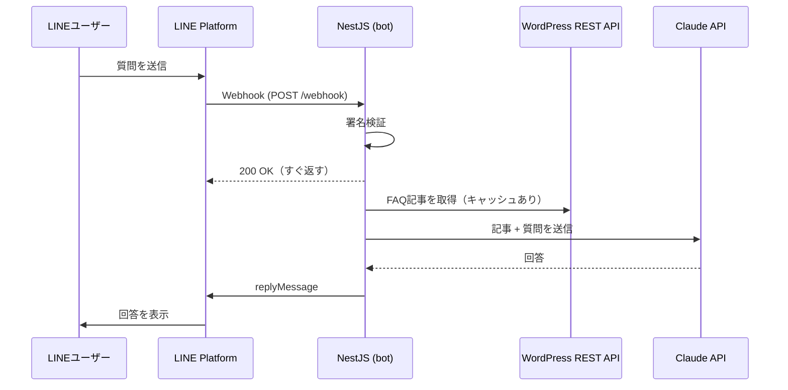

# 社内FAQ LINE bot 設計書

## 1. 目的
Claude API・LINE・WordPress を連携し、「社内の情報をAIが答える」業務効率化の仕組みを小さく作る。
WordPress を社内データベースに見立て、そこからデータを取り出してAIと連携する流れを一通り実装する。

## 2. 完成の定義
- LINE で質問すると、WordPress の FAQ 記事をもとに Claude が回答する
- 記事に書かれていない質問には「見つかりませんでした」と答え、内容をでっち上げない
- 回答の最後に、参照した記事のタイトルを付ける
- README に構成図・セットアップ手順・デモ GIF（または動画）がある
- 目安：週末1〜2日

## 3. 想定シナリオ
架空の会社「サンプル株式会社」の社内FAQを WordPress に10件ほど登録する。
例：経費精算のルール、有給休暇の申請方法、PC・備品の貸出、入館証の再発行、在宅勤務の申請、交通費の上限 など。
社員が LINE で「交通費っていくらまで出る？」のように質問すると、該当記事をもとに回答する。

## 4. 構成



## 5. モジュール構成

```
src/
  main.ts                  # NestFactory.create(AppModule, { rawBody: true })
  app.module.ts
  config/                  # ConfigModule と環境変数のバリデーション
  line/
    line.controller.ts     # POST /webhook
    line.service.ts        # 署名検証・返信
  wordpress/
    wordpress.service.ts   # 記事取得・HTML除去・キャッシュ
  ai/
    ai.service.ts          # Claude 呼び出し・プロンプト組み立て
  faq/
    faq.service.ts         # 全体の流れ（記事取得 → 回答生成）
```

## 6. 処理フロー
1. `POST /webhook` を受信する
2. `x-line-signature` ヘッダーを rawBody で検証する。失敗したら 401
3. LINE には 200 をすぐ返し、イベントの処理は非同期で行う
4. テキストメッセージ以外（スタンプ・画像など）には「文章で質問してください」と定型返信する
5. WordPress から FAQ 記事を取得する（`/wp-json/wp/v2/posts?per_page=100&_fields=id,title,content,link`）
   - HTML タグを除去してプレーンテキストにする
   - 取得結果は5分間メモリにキャッシュする
6. Claude に「記事一覧 + 質問」を渡して回答を生成する
7. `replyMessage` で返信する

記事数が少ない前提なので、最初は全記事をそのまま Claude に渡す。検索での絞り込みは発展案（12章）とする。

## 7. プロンプト方針
- system プロンプトの要点
  - あなたはサンプル株式会社の社内FAQ担当
  - `<documents>` 内の情報だけを使って答える
  - 該当する情報がなければ「FAQに見つかりませんでした。担当部署に確認してください」と答える
  - 回答は300字以内、LINE で読みやすい短い文で
  - 最後に「参照：記事タイトル」を付ける
- 記事は `<document title="..." url="...">本文</document>` の形で `<documents>` に入れる
- 質問はユーザーメッセージとして渡す

## 8. 環境変数（`.env.example` に記載）

| 変数名 | 内容 |
|---|---|
| `LINE_CHANNEL_SECRET` | LINE チャネルシークレット |
| `LINE_CHANNEL_ACCESS_TOKEN` | LINE チャネルアクセストークン（長期） |
| `ANTHROPIC_API_KEY` | Claude API キー |
| `ANTHROPIC_MODEL` | 使用モデル（既定：`claude-haiku-5-5`） |
| `WP_BASE_URL` | WordPress の URL（既定：`http://localhost:8080`） |
| `PORT` | bot のポート（既定：3000） |

## 9. エラー処理とログ
- WordPress や Claude の呼び出しに失敗したら「ただいま回答できません。時間をおいてお試しください」と返信し、エラー内容をログに出す
- ログにトークン・APIキーを出さない
- 質問本文のログ出力は開発時のみ（`NODE_ENV=development`）

## 10. テスト
- `WordpressService`：HTML 除去のユニットテスト
- `AiService`：プロンプト組み立てのユニットテスト（API 呼び出しはモック）
- e2e：署名が不正なリクエストに 401 を返すこと

## 11. フェーズ（1フェーズ = 1ブランチ = 1PR）

### Phase 0：準備（人が行う）
- LINE Developers で Messaging API チャネルを作成し、シークレットとアクセストークンを取得
- Claude Console で API キーを発行（利用にはクレジットの購入が必要）
- Docker Desktop と ngrok をインストール

### Phase 1：オウム返し bot（`feature/echo-bot`）
- NestJS の雛形、ConfigModule、`.env.example`
- Webhook 受信と署名検証、受け取った文をそのまま返す
- ngrok 経由で LINE から動作確認

### Phase 2：WordPress 連携（`feature/wordpress`）
- `docker-compose.yml`（wordpress + mysql）
- サンプルFAQ記事10件を投入するシードスクリプト（WP-CLI コンテナを使用）
- `WordpressService` で記事取得・HTML 除去・キャッシュ

### Phase 3：Claude で回答（`feature/claude-answer`）
- `AiService` と `FaqService`
- 7章のプロンプト方針どおりに回答を生成して返信
- 記事にある質問・ない質問の両方で動作確認

### Phase 4：仕上げ（`feature/polish`）
- エラー処理、テスト、README（構成図・手順・デモ GIF）

### Phase 5（任意）：デプロイ
- Railway などに bot と WordPress を置き、ngrok なしで動くようにする

## 12. 発展案（面談で話せるネタ）
- 回答できなかった質問を Google スプレッドシートに記録し、FAQ 追加の候補にする（Google 連携）
- 記事が増えたら WordPress の検索 API やカテゴリで絞り込み、さらにベクトル検索へ
- 会話履歴を保持して「それって申請はどこから？」のような追加質問に対応
- 経費の質問から申請フォームへ誘導し、経理ツール（マネーフォワード等）との連携につなげる
- 管理者向けに「よく聞かれた質問」の週次レポートを自動送信

## 13. やらないこと
- ユーザー認証・権限管理
- 本番運用レベルの監視・スケーリング
- WordPress のテーマやプラグインの改修
